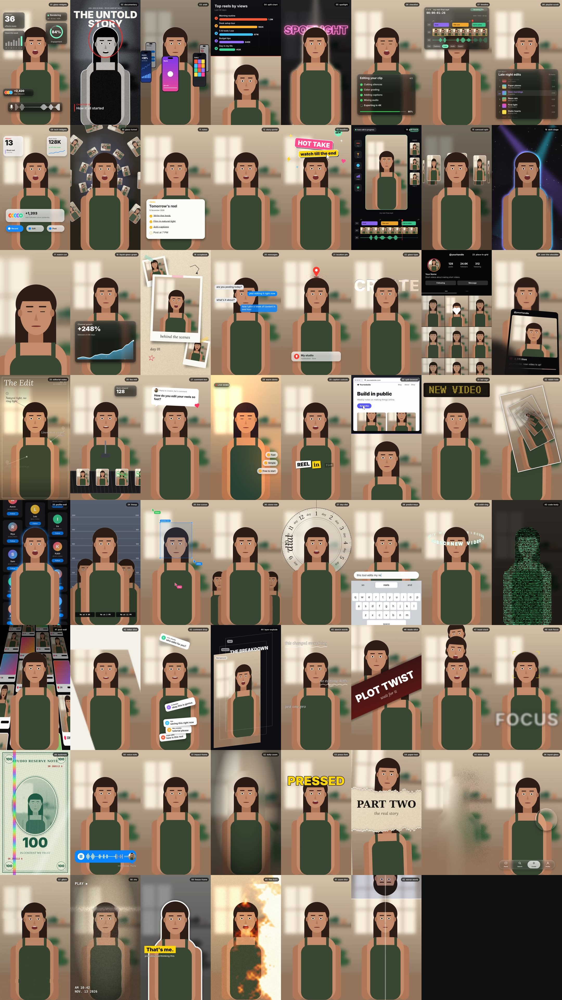

# Reel Effects

62 motion-graphics effects for vertical (9:16) talking-head videos — glass widgets, documentary poster, orbiting phones,
neon spotlight, editor timeline, story portal, code body, blow-away particles, liquid glass, glitch, VHS and more.
One Python file, rendered with ffmpeg. The original audio is kept and output files carry no metadata or encoder tags.



## Quick start
```bash
pip install numpy opencv-python-headless pillow onnxruntime onnx   # onnx* optional (better cut-outs)
python3 effects.py --list
python3 effects.py my_clip.mp4 out.mp4 -e orbit
python3 effects.py my_clip.mp4 out.mp4 -e glass-widgets,spotlight,timeline --seg 3     # one effect per 3 s
python3 effects.py my_clip.mp4 out.mp4 -e documentary --text "THE UNTOLD|STORY"        # main text, | = new line
python3 effects.py my_clip.mp4 out.mp4 -e split-chart --config cfg.json                 # full options
```
`cfg.json` example:
```json
{"split-chart": {"title": "Top reels by views", "data": [["Morning routine", 1240000], ["Desk tour", 982000]]},
 "*": {"accent": "#7CF5C4"}}
```
Other flags: `--start / --duration` (process a section), `--stills 1.5,3` (save PNG frames), `--mask auto|ai|silhouette`,
`--label` (burn effect names for a showcase), `--crf`, `--fps`.

Effects marked ✂ separate the speaker from the background with a small matting model (u2netp, 4.5 MB, fetched from the
rembg GitHub release on first use and cached in `~/.cache/vfx-effects`). Without it a soft silhouette is used.

## Effects
| # | Effect | What it does |
|---|---|---|
| 1 | `glass-widgets` | Frosted-glass stat widgets (counter, status, ring meter, bar chart, followers, live audio) pop in around the speaker. |
| 2 | `documentary` ✂ | Black-and-white documentary poster: huge headline behind the speaker, white cut-out outline, red hand-drawn circle, chapter lower-third, film grain. |
| 3 | `orbit` ✂ | Six phone screens orbit around the speaker in 3D, passing behind and in front of them. |
| 4 | `split-chart` ✂ | Split screen: an animated 'top reels by views' bar chart on top, the speaker below. |
| 5 | `spotlight` ✂ | Room goes dark, a stage spotlight hits the speaker and a flickering neon title glows behind them. |
| 6 | `checklist` | Glass checklist card ticks off editing steps one by one with spinners and a live progress bar. |
| 7 | `timeline` | Video-editor timeline UI slides in on top: text, thumbnail and waveform tracks with a moving playhead and render progress. |
| 8 | `playlist-scroll` | Music-app style 'Up next' playlist card scrolls through tracks; the playing track gets live equaliser bars. |
| 9 | `tech-widgets` | Phone home-screen style widgets: calendar, reel views with sparkline, new followers and tappable quick-action buttons. |
| 10 | `glass-tunnel` ✂ | The speaker stands inside a 3D tunnel of glass video panels flying toward the camera. |
| 11 | `notes` | Notes-app style to-do card ('Tomorrow's reel') checks itself off while you talk. |
| 12 | `story-portal` | Social 'stories' row appears, a story bubble is tapped and expands like a portal into the next shot. |
| 13 | `headline` | Loud sticker-style title cards pop in with sparkles, stickers and a clicking cursor (yap-style content). |
| 14 | `pull-back` | Camera pulls back to reveal the clip is being edited inside an editor dashboard (tools, layers, timeline). |
| 15 | `carousel-spin` ✂ | A ring of video cards spins behind the speaker like a carousel and eases to a stop. |
| 16 | `dark-stage` ✂ | Background becomes a dark concert stage: sweeping colour beams, haze particles and coloured rim light on the speaker. |
| 17 | `match-cut` ✂ | Punch-in match cuts on the beat: hard cuts between wide and tight framings with a flash and camera shake. |
| 18 | `liquid-glass-graph` | Glass card with a growth graph that fills like liquid: wavy surface, rising bubbles, count-up number. |
| 19 | `scrapbook` | Scrapbook collage: the clip plays inside a tilted polaroid on paper, with tape, extra snapshots, doodles and a handwritten caption. |
| 20 | `messages` | Chat bubbles pop in one by one (with a typing indicator) above the speaker, like a text conversation. |
| 21 | `location-pin` ✂ | A map pin drops onto the speaker with a bounce and radar pulses, and a location card slides in. |
| 22 | `glass-type` ✂ | Giant frosted-glass lettering behind the speaker that refracts the room, with a moving light glint. |
| 23 | `place-in-grid` ✂ | The clip shrinks into a tile of a profile grid, revealing the profile header and other posts. |
| 24 | `over-the-shoulder` | Over-the-shoulder shot: a phone screen in the foreground plays your post with live likes, with an out-of-focus shoulder. |
| 25 | `editorial-notes` ✂ | Magazine editorial look: serif masthead, warm film grade, thin frame and numbered annotation call-outs that draw onto the speaker. |
| 26 | `the-mill` | Content mill: video cards ride a conveyor belt under the speaker, get stamped 'POSTED' and a shipped counter ticks up. |
| 27 | `comment-box` | Reply-to-comment sticker pops in at the top (avatar, username, comment) with a little heart. |
| 28 | `warm-demo` | Warm film grade with drifting light leaks, a LIVE DEMO badge and feature pills that slide in beside the speaker. |
| 29 | `caption-cutouts` | Word-by-word captions made of ransom-note paper cut-outs (mixed colours, fonts and angles) that pop in as you speak. |
| 30 | `split-browser` ✂ | Split screen: a browser window on top scrolls your website while a cursor clicks; the speaker is below. |
| 31 | `led-sign` | Glowing LED dot-matrix sign scrolls your message across the top of the frame. |
| 32 | `rabbit-hole` ✂ | Falling down the rabbit hole: the frame repeats inside itself, twisting and zooming endlessly toward your face. |
| 33 | `profile-wall` ✂ | Background becomes a scrolling wall of profile cards (avatars, names, follow buttons) behind the speaker. |
| 34 | `lineup` ✂ | Three of you in a lineup against a height-chart wall: delayed clones either side, each with a name plate. |
| 35 | `live-cursor` ✂ | Multiplayer design-tool cursors with name tags glide around; one drags a selection box around your head. |
| 36 | `clone-row` ✂ | A row of time-delayed clones of you appears across the frame, each popping in one after another. |
| 37 | `day-dial` ✂ | A giant engraved dial with 'day' markings rotates behind you and clicks onto today's day number. |
| 38 | `predict-keys` | Phone keyboard types your caption with key pops, while predictive-text suggestions complete each word. |
| 39 | `orbit-ring` ✂ | A ring of glowing text orbits around your head in 3D, passing behind and in front of you. |
| 40 | `code-body` ✂ | Your body turns into scrolling code characters (matrix style) while the room goes dark. |
| 41 | `post-wall` ✂ | A tilted 3D wall of social posts (thumbnails, likes) scrolls behind you. |
| 42 | `letter-dive` | The frame becomes a giant word with you visible through the letters, then the camera dives into a letter. |
| 43 | `comment-drop` | Viewer comments fall from the top, bounce and pile up in front of you. |
| 44 | `layer-explode` ✂ | Exploded 3D view: the shot splits into background, you and a text layer that fan out with labels, then snap back. |
| 45 | `sketch-words` ✂ | Hand-written words, scribbled underlines and arrows draw themselves around you, pointing at you. |
| 46 | `blade-slice` | A glowing blade slashes across the frame; the two halves slide apart to reveal a title card, then slam back together. |
| 47 | `head-stack` ✂ | Copies of your head stack up into a wobbling totem above you, popping in one by one. |
| 48 | `rack-focus` ✂ | Cinematic rack focus: a foreground title is sharp first, then focus pulls to you and an AF box locks on. |
| 49 | `banknote` ✂ | You become the portrait on an engraved (fictional) banknote: guilloche patterns, serials, holographic strip. |
| 50 | `voice-note` | Chat voice-message bubble plays your actual audio: live waveform fills as it plays, timer counts up. |
| 51 | `impact-frame` ✂ | Anime impact frames on the beat: inverted ink frame with speed lines, red two-tone, flash and screen shake. |
| 52 | `dolly-zoom` ✂ | Vertigo dolly zoom: you stay the same size while the room stretches away behind you. |
| 53 | `press-font` | A hydraulic press slams down on your title, squashing it flat before it springs back with a wobble. |
| 54 | `paper-tear` | The frame rips open like paper along a jagged tear, revealing a title page underneath. |
| 55 | `blow-away` ✂ | You disintegrate into particles that blow away on the wind, leaving the empty room behind. |
| 56 | `liquid-glass` | Liquid-glass UI: a refractive glass lens glides over the shot magnifying it, above a glass tab bar with a sliding selector. |
| 57 | `glitch` | Digital glitch bursts: RGB split, sliced scanline displacement, corrupted blocks and flicker on a rhythm. |
| 58 | `vhs` | Old VHS tape look: chroma bleed, wobbling lines, tracking noise band, scanlines and a PLAY / date on-screen display. |
| 59 | `freeze-frame` ✂ | 'Yep, that's me' freeze frame: the shot freezes, you pop out as a sticker cut-out and a highlighted name tag slides in. |
| 60 | `film-burn` | Analogue film look with an organic orange film burn that flares across the frame, gate weave, grain and dust. |
| 61 | `zoom-blur` ✂ | Punch-in zoom with radial motion blur on every beat, centred on your face. |
| 62 | `mirror-world` ✂ | Reality folds: a mirror seam sweeps in to make you symmetrical, then the ceiling folds down into an upside-down mirror world. |

## Requirements
Python 3.9+, ffmpeg/ffprobe on PATH, numpy, opencv-python-headless, pillow. Optional: onnxruntime + onnx.
Speed is roughly 4–6 seconds of compute per second of 1080×1920 video on a laptop CPU.
